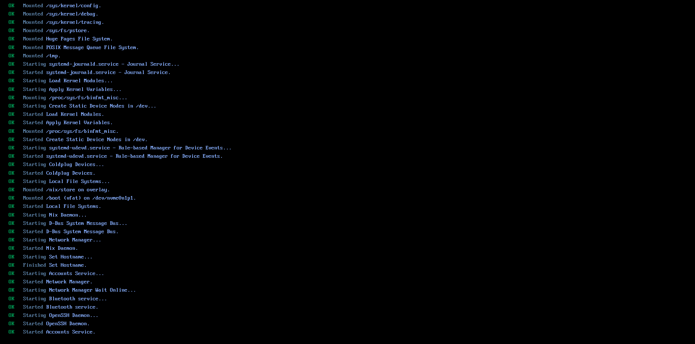
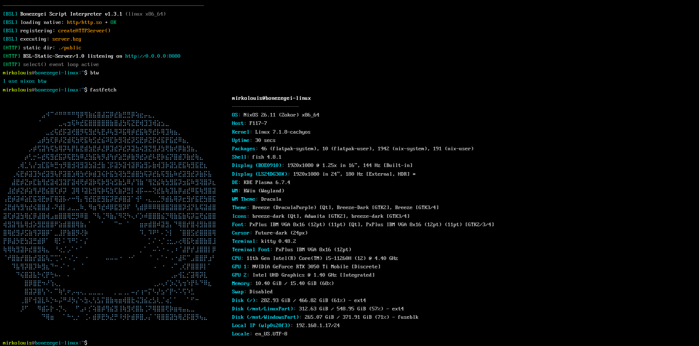

# Overcomplicating a Bonezegei GET Request

## The Bonezegei Scripting Language (BSL)
The [Bonezegei Scripting Language (BSL)](https://github.com/bonezegei/Bonezegei_Scripting_Language) is a minimalistic, esoteric scripting language utilized in this project to strictly handle the backend operations. By design, BSL acts as a bare-bones environment. In this project, BSL is used to load a native C-like extension (`http/http.so`), manually register an HTTP server (`createHTTPServer()`), and bind a `select()` event loop to port `8080`. Its sole responsibility is to serve static payloads out of the `./public` directory.

### BSL vs JavaScript (Node.js)
If this backend had been built with JavaScript (e.g., using Node.js), the implementation would differ drastically:
- **Ecosystem and Abstraction**: JavaScript offers high-level frameworks like Express.js that abstract away socket binding and file streaming. BSL requires low-level manual orchestration of the static directory and event loop.
- **Asynchronous vs Blocking**: Node.js relies on an inherently asynchronous, non-blocking I/O model driven by libuv. BSL utilizes a more traditional `select()` event loop that ticks linearly to process requests.
- **Ubiquity**: JavaScript is a ubiquitous industry standard with the V8 engine, while BSL provides an educational constraint-based challenge that forces developers to work closely with system-level paradigms.

## Screenshots




## Tech Stack
- **Backend:** Bonezegei Scripting Language (BSL v1.3.1)
- **Frontend:** Pure HTML, CSS, and Vanilla JavaScript (Custom TTY Emulator)
- **Typography:** PxPlus IBM VGA 8x16 (for pixel-perfect retro aesthetics)
- **Environment:** NixOS Host / Ubuntu Distrobox

## How to Install and Run
1. Ensure the **[Bonezegei Script Interpreter](https://github.com/bonezegei/Bonezegei_Scripting_Language)** (`bonezegei`) is installed and available in your system's `PATH`.
2. Clone this repository.
3. Start the server using the Bonezegei CLI:
   ```bash
   bonezegei server.bzg
   ```
4. Open your web browser and navigate to `http://localhost:8080/`.

## License
This project is open-source and available under the [MIT License](LICENSE).
